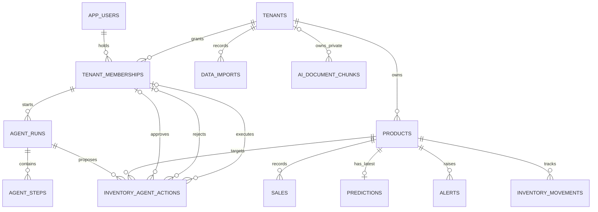

# OpsPulse fresh database schema specification

Phase 1 proposal for a new Supabase project. React continues to call Express, and Express continues to call FastAPI through the existing internal token boundary. Both server services use PostgreSQL. Clerk supplies authentication, Express resolves authorization, and LangGraph stays inside FastAPI. Historical data remains in the archive.

## Entity relationships

The LangGraph saver owns four tables in a private schema. The application associates runs with saver threads by namespace and identifier, without a relational foreign key into the library tables.

## Table definitions and indexes

The [proposed SQL](opspulse-fresh-schema.proposed.sql) specifies each column's exact type, nullability, default, key, and check. Existing business and agent row IDs use UUIDs. Tenant and app-user IDs use bounded strings with generated UUID text defaults for compatibility with existing string-based contexts. Timestamps use PostgreSQL timestamps with time zone. All entity IDs are opaque.

| Table | Columns and supported behavior | Keys, checks, and access paths |
| --- | --- | --- |
| `app_users` | Internal ID, unique Clerk subject, creation time. Clerk owns profile and login data. | Primary key on internal ID and exact, nonempty subject uniqueness. |
| `tenants` | ID, display name, creation time. | Primary key, nonempty name, and ID check compatible with tenant context. The character set excludes the current checkpoint delimiter. |
| `tenant_memberships` | Tenant, internal user, role, creation and revocation time. Two proposed roles support bootstrap ownership and ordinary access. | Composite primary key, both parent FKs, active-user lookup. Revoke by timestamp to preserve actor references. |
| `products` | ID, tenant, name, category, stock quantity, reorder threshold, creation/update times, nullable legacy ID. | Composite tenant/product key for children, nonnegative stock and threshold. Tenant-prefixed name, category, exact import lookup, reorder, and legacy lookup indexes. Business duplicate policy remains as implemented pending a decision on concurrency and name normalization. |
| `sales` | ID, tenant, product, sale timestamp, positive integer quantity, creation time. | Composite product FK and unique tenant/product/timestamp, matching both writers. The SQL preserves the exact unique-constraint names expected by the Express schema readiness check for sales and predictions. Tenant/date range index. Existing API day normalization stays an application concern. |
| `predictions` | ID, tenant, product, four demand estimates, sales average, percent change, confidence, season, decision, impact, keyword, score, headline and headline list, matched keywords, reason, contributing factors, source, prediction time, and horizon. | Composite product FK, one latest prediction per tenant/product, tenant/time index. Existing enum checks and positive horizon with default 30. Models and controllers use forecast runs as computations without a separate forecast persistence table. |
| `alerts` | ID, tenant, product, demand/trend type, message, severity, percent change, active flag, creation time, nullable legacy ID. | Composite product FK, existing demand-type and severity checks, tenant/product and tenant/severity indexes, partial active lookup, and tenant-local partial legacy uniqueness. |
| `data_imports` | ID, tenant, filename, processed/valid/invalid counts, status and creation time. | Tenant FK and tenant/time index. Nonnegative counts. The current CSV transaction writes completed imports. |
| `inventory_movements` | ID, tenant, product, movement type, positive quantity, reason, creation time. The current balance resides on products. | Composite product FK, movement-type check for initial, adjustments in/out, and sale. Tenant/product/time and tenant/type/time indexes. The application performs locking, balance updates and movement insertion together. |
| `ai_document_chunks` | ID, nullable tenant, document key, title, section, text, content hash, nullable 384-dimensional vector, version, JSON metadata, and timestamps. | Tenant FK for private rows, separate partial shared/private uniqueness, and partial cosine HNSW index for non-null embeddings. A null tenant is reserved for explicitly published platform documentation. |
| `agent_runs` | ID, tenant, initiating app user, thread ID, trigger type/metadata, question, status, execution plan, selected agents, final answer, confidence, limitations, error, timestamps and duration. | Composite membership FK and tenant/run key. Checked trigger and status sets, tenant/time, status, user and thread indexes. Thread uses text to support opaque, server-generated IDs. |
| `agent_steps` | ID, tenant, parent run, step number, agent/node names, status, input/output JSON, tool calls, error, timestamps and duration. | Composite run FK, nonnegative step, checked status, and tenant/run/step uniqueness. Also retains run/step uniqueness for the current tracker conflict target during the transition. |
| `inventory_agent_actions` | ID, tenant, run, product, recommendation snapshot, state, approval/rejection/execution actors and times, execution result/key, creation/update times. | Composite run, product and actor membership FKs. Unique tenant/run/product and tenant/execution key. Checks pair actor and timestamp and align them with status. Tenant/product index supports target lookups. |

Each action can receive one approval or rejection. The action row preserves that decision and records eventual execution, matching the existing UI and state machine. An append-only event stream would be a separate scope if repeated decisions or retention after run deletion are required. Application code must enforce allowed transitions and keep recommendation snapshots immutable. Product deletion is restricted while dependent rows exist, including agent actions. The current Express dependency check should include those actions and translate a concurrent FK violation into the existing conflict response.

Inventory Intelligence computes stock alerts and recommendations from product balances, movement and demand inputs. Demand/trend alerts use the existing alerts table. The Inventory Agent persists actionable replenishment recommendations as snapshots. Neither implementation requires an extra inventory-alert table. CSV imports currently add historical sales for forecasting without reducing stock or fabricating movements. Confirm this remains the intended import behavior before rollout. Sources include [inventory calculations](../backend/src/services/inventoryIntelligence.js), [actions](../backend/src/controllers/inventoryAgentController.js), and [operational SQL](../backend/src/config/postgres.js).

## Migration trace

| Migration | Fresh schema treatment |
| --- | --- |
| [001](../db/migrations/001_initial_schema.sql) | Business tables and domain constraints, with explicit tenant ownership and composite child keys. |
| [002](../db/migrations/002_alert_legacy_mongo_id.sql) | Nullable compatibility column and tenant-local partial index. Newly created records have no historical ID. |
| [003](../db/migrations/003_ai_analyst_rag.sql) | pgvector, document chunks, cosine HNSW index, and tenant-aware uniqueness from 005. |
| [004](../db/migrations/004_agent_runs_and_steps.sql) | Run and step tracking, explicit actor identity and tenant-preserving run relationships. |
| [005](../db/migrations/005_tenant_isolation.sql) | Final tenant columns, composite relationships, and shared documents. The clean bootstrap needs no ownership backfill or default tenant. |
| [006](../db/migrations/006_inventory_foundation.sql) | Balance column and movement ledger. |
| [007](../db/migrations/007_inventory_intelligence.sql) | Reorder threshold and prediction horizon. |
| [008](../db/migrations/008_inventory_agent_actions.sql) | Action snapshots, decisions and execution results, with tenant-preserving product, run and actor FKs. |

## Tenant isolation and Clerk integration

1. React obtains the Clerk session token and sends it through the shared API client. Express verifies the token and uses its Clerk subject for an exact lookup in `app_users`. The repository currently implements Firebase, and has no Clerk SDK integration. The Firebase Admin verifier populates `req.user`, the tenant middleware uses its UID and membership claims, and React reads the same token claims. These are the identity assumptions that must change. Sources include [frontend API client](../frontend/src/services/api.js), [Firebase verification](../backend/src/middleware/firebaseAuth.js), and [tenant resolution](../backend/src/middleware/tenantContext.js).
2. Express queries active memberships for the resolved internal user. An optional tenant supplied by the client selects among those memberships. New Clerk registrations gain tenant access through explicit provisioning. The proposed owner/member roles leave the precise permissions for inventory decisions as a rollout decision. Avoid using email, Firebase IDs, frontend headers, Clerk public metadata, or Supabase Auth identities as ownership evidence.
3. Express passes the resolved internal user ID, authorized tenant and existing internal service token to FastAPI. The Clerk secret stays in Express. FastAPI uses trusted context for every tool, query, write and checkpoint operation. RLS protects tenant data in addition to query predicates and composite joins.
4. The proposal enables and forces RLS and revokes browser and Supabase API role access to application tables. Future runtime grants belong to dedicated least-privilege server roles without ownership or `BYPASSRLS`. On each relevant transaction, the service sets transaction-local context with parameterized `set_config` on the database connection that executes the queries. Set the verified subject for identity lookup, internal user ID for membership lookup, and tenant ID only after authorization. Missing settings yield no tenant rows. RLS based on settings trusts the server role to set truthful context. Keep its credentials server-only and continue parameterizing SQL. Role provisioning, operator-only membership writes, and the transaction wrappers are deployment work. The proposed SQL grants no runtime role access.
5. Private RAG writes require matching tenant context. Authenticated server requests may retrieve their own chunks and intentionally published platform chunks. Shared chunk writes use a separately authorized publisher. Confirm that the runtime and publisher search paths resolve the installed pgvector types and operators. Validate recall of filtered HNSW search on representative data before tuning indexes.

## Query and write audit

The frontend uses the Express API for dashboard, products, sales, alerts, CSV uploads, forecasting, predictions, news, inventory, Analyst and Inventory Agent. It has no PostgreSQL table access. News and forecast paths that load product or demand series inherit the data access rules below.

| Source | Reads and writes that require tenant context |
| --- | --- |
| [Express PostgreSQL adapter](../backend/src/config/postgres.js) | All product listing/search, counts, legacy lookups, name/category lookups, inserts, edits, delete/dependency checks and locks. All sales counts, history, series, joins, CSV bulk inserts and manual sale inserts. All inventory health, stock locks/updates and movement reads/inserts. All prediction counts, cached reads and product-validated upserts. All alert reads/counts/inserts/deactivations/deletes and refresh/upserts. CSV import receipts and any future receipt reads. Scope every statement in a transaction, including retries and conflict lookups, and retain tenant predicates on both sides of joins. Catalog checks for schema readiness can run outside request RLS context. |
| [Express Inventory Agent](../backend/src/controllers/inventoryAgentController.js) | Scope recommendation inserts, run/action history aggregation, decisions, locking reads, state transitions, stock adjustment, and stale/final updates. Composite keys validate the returned run and product against the tenant. Preserve status predicates and use one transaction for stock, movement and final outcome. The existing code commits the executing state before adjusting stock and finalizes separately, so crashes can strand actions or leave inconsistent results. The proposed execution key alone does not make stock writes idempotent. |
| [FastAPI PostgreSQL helpers](../ml-service/postgresService.py) | Scope UUID and legacy product resolution, name lookup, raw and aggregated sales, and diagnostic counts. Remove or isolate tenantless compatibility branches and ensure missing context fails closed. |
| [Analyst evidence and retrieval](../ml-service/rag_service.py) and [tool registry](../ml-service/tools) | Scope product resolution, summary counts, planned and fallback queries, sales windows, prediction comparisons, active alerts, and tool queries in products, sales, KPIs, inventory and forecasting. Keep cross-table joins tenant-aware and apply the private/shared RAG rule before results can enter model context. Remove missing-context branches from deployed request paths. |
| [RAG seeder](../ml-service/seed_rag_documents.py) | Platform publication is privileged. Private ingestion uses authenticated tenant scope. Match each upsert to its corresponding partial unique index, including the conflict predicate. The current shared seeder needs WHERE tenant_id IS NULL on the ON CONFLICT target to match the partial unique index. Retire the pre-tenant SQL branch for the fresh project. |
| [Run tracker](../ml-service/tracking/tracker.py) | Scope run creation, run status updates, step inserts/upserts, run reads and step reads. The status update currently filters only by run ID. Add tenant to that predicate and the step conflict target. Durable run persistence must succeed before actions can reference it. In-memory fallback alone cannot support durable action history. |
| [LangGraph Analyst](../ml-service/workflow/minimal_graph.py) and [Inventory Agent workflow](../ml-service/workflow/inventory_agent.py) | Authorize saver reads, writes, resumes and deletion through the trusted tenant and owner of the thread. Remove silent identity defaults from production workflow entry points. |

## LangGraph persistence

The current app constructs a PostgreSQL saver over a psycopg pool and calls `PostgresSaver.setup()` when PostgreSQL mode is enabled. Use the installed package's setup as the versioned DDL authority, with an approved setup role and a search path starting in the private `opspulse_checkpoints` schema. Pin the tested saver version before deployment. The SQL proposal creates and protects the schema. Running setup and separating bootstrap from runtime access are later deployment steps. The production ML runtime needs the appropriate PostgreSQL configuration and explicit PostgreSQL checkpoint mode. Check development fallback behavior separately.

| Saver table | Required layout observed in the local schema baseline |
| --- | --- |
| `checkpoint_migrations` | Integer version `v` as primary key. The saver owns this ledger. |
| `checkpoints` | Text thread ID, namespace and checkpoint ID as composite PK, optional parent ID and type, JSONB checkpoint and metadata. |
| `checkpoint_blobs` | Text thread, namespace, channel and version as composite PK, text type and nullable BYTEA blob. |
| `checkpoint_writes` | Text thread, namespace, checkpoint and task ID plus integer index as composite PK, text channel, optional type, BYTEA blob and text task path. |

The saver layout has thread-ID lookup indexes and owns its migrations and defaults. It has no tenant column. A deployment must verify the configured ML pool uses the private schema, that the Express and Supabase API roles lack access, and that checkpoint keys are generated from trusted server-side tenant and user or authorized thread ownership. The current tenant prefix alone cannot authorize another user's thread in the same tenant. Validate thread ownership before resume, including for client-provided thread IDs, and test application restart, cross-user and cross-tenant access, and saver upgrades. Sources include [checkpoint manager](../ml-service/workflow/minimal_graph.py) and [schema-only baseline](database-schema-baseline.sql).

## Initial seed and rollout checks

- Provision the first real tenant and verified Clerk user through an authorized operator, then create their owner membership in the same transaction. Keep production inventory, sales, predictions, alerts, imports, run history and checkpoint records empty initially.
- Publish reviewed shared platform documentation through the RAG seeder. Generate embeddings compatible with the selected 384-dimensional model. Keep any development sample data in dedicated test tenants and cover both shared and private retrieval.
- Before rollout, verify on a disposable new database that composite FKs reject cross-tenant relationships, RLS rejects missing or foreign context, pool reuse does not leak settings, and revoked memberships block access. Exercise uploads, sales and inventory atomic writes, product deletion, RAG seeding and retrieval, prediction upserts, checkpoint resume, and duplicate or interrupted replenishment execution.
- Confirm the operator provisioning workflow, role permissions, database grant split, and checkpoint package version before application changes. Scheduling tables, event ingestion infrastructure, and provider credentials in PostgreSQL are outside this proposal. Existing agent trigger fields can represent scheduled or event-triggered runs when orchestration is implemented.
